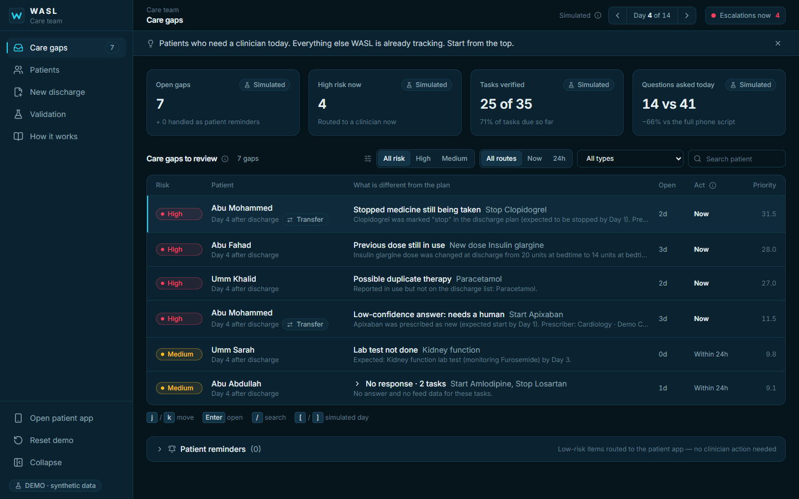
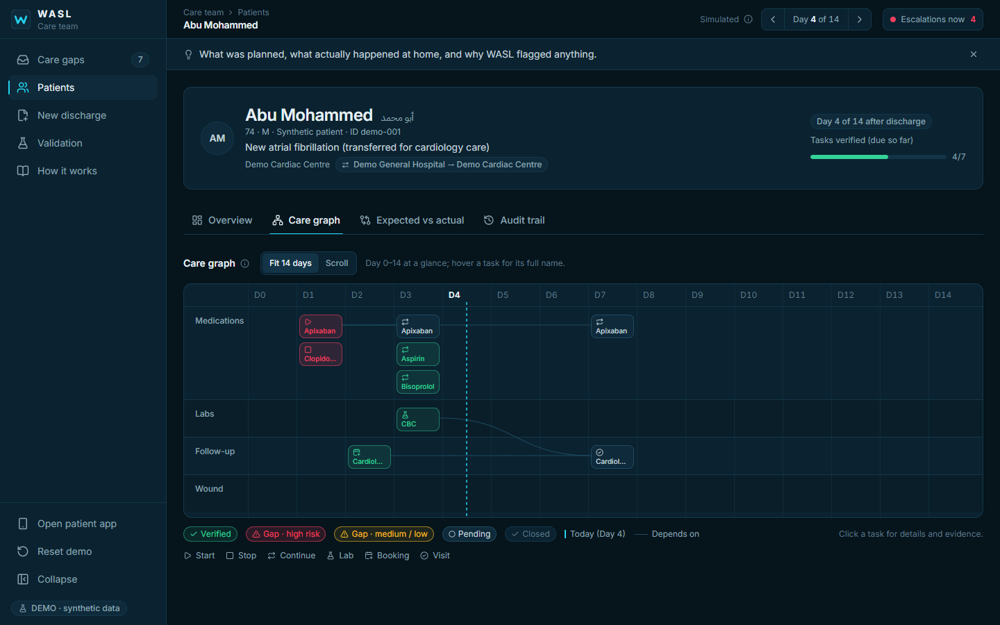
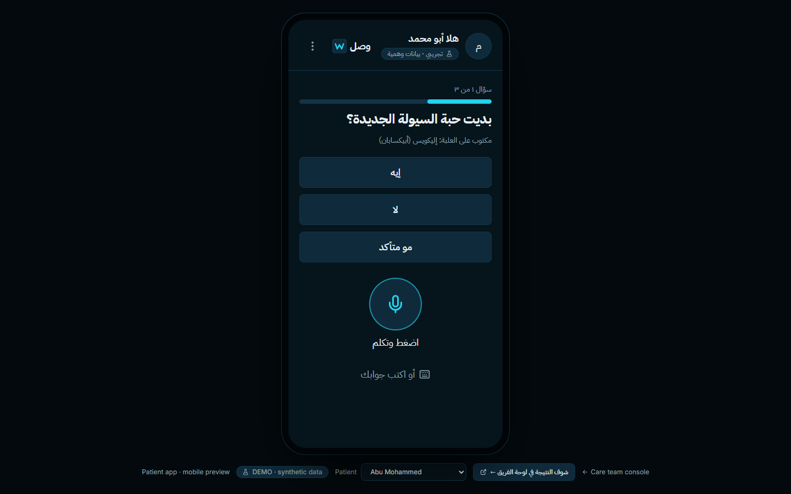
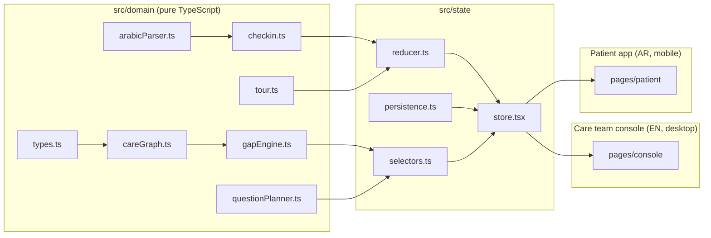

# WASL (وصل): The Executable Discharge Plan

**Turning discharge instructions into verified recovery actions.**

[](https://ameer389.github.io/wasl-mvp/)
[](https://ameer389.github.io/wasl-mvp/#/)


- **Live demo:** https://ameer389.github.io/wasl-mvp/ (replace `ameer389` with the GitHub user or org that hosts the repo)
- **Start the guided demo (3 min):** open the live demo and press *Start the guided demo*. It follows one synthetic patient from discharge to a resolved care gap.

> **Research prototype. Not a medical device. Synthetic data only.** WASL never recommends doses, prescribes or diagnoses. It surfaces gaps and routes them to a human.

---

## The problem

After discharge, nobody checks what actually happens at home. Medicines get stopped on paper but kept at home, new doses are not started, labs and follow-ups slip. The gap is found late, if at all.

## What WASL does

1. **Plan → tasks.** A discharge plan becomes a care graph: each medicine, lab and follow-up is a task with an owner, a deadline and a risk level.
2. **Patient answers.** Each day the patient or a family member answers a few questions, by voice in Saudi dialect or with big buttons. Only what is still uncertain is asked.
3. **Expected vs actual.** The engine compares what the plan expected with what was answered and what the lab and appointment systems report, and raises gaps with the rule that fired.
4. **Clinician acts only on gaps.** Gaps are ranked by risk and routed: *now*, *within 24h*, or *patient reminder*. Every action is written to an audit trail.

## Screenshots

| Care gaps queue | A gap explains itself |
|---|---|
|  |  |
| **Care graph (Fit 14 days)** | **Patient check-in question** |
|  |  |

**Patient echo:** 

## What is real vs simulated

| Area | Status |
|---|---|
| Care graph generation from a discharge plan | ✅ Built and tested |
| Gap engine (10 gap types, verification threshold, routing, resolutions) | ✅ Built and tested |
| Saudi-dialect answer parser (rule-based, explainable) | ✅ Built, evaluated on a labelled set |
| Adaptive question planner | ✅ Built and tested |
| Clinician console (queue, patients, detail, graph, expected vs actual, audit, new discharge) | ✅ Built, runs in the browser |
| Patient app (check-in, family mode, medicines, appointments, help) | ✅ Built, runs in the browser |
| Voice input | ⚠️ Browser Web Speech API (Chrome, Edge, Safari). Not available in Firefox. |
| Patients, labs, appointments, answers | 🧪 Simulated: synthetic patients and a simulated clock |
| EHR / FHIR integration | ❌ Not built |
| Real database, persistence beyond the browser | ❌ Not built (state is in memory and localStorage) |
| Authentication and roles | ❌ Not built |
| Notifications to patients and clinicians | ❌ Not built |
| Production Saudi-dialect speech recognition | ❌ Not built |

## Safety by design

- **No autonomous clinical decisions.** Reasons are descriptive and tested not to be prescriptive (no "increase", "stop taking", "double", …).
- **Low confidence goes to a human.** Answers below 70% confidence never verify a task. They become a gap for a clinician. Uncertain answers are routed the same way.
- **Explainable.** Every gap shows the expected task, the evidence (with the patient's exact words), and the rule that fired.
- **Audit trail.** Every answer, call, confirmation and resolution is recorded with the day, time, actor and note.
- **Synthetic data only.** No real patient data. Every screen shows a *DEMO · synthetic data* badge.
- **Voice privacy.** The browser's speech service sends audio to the browser vendor (Google for Chrome, Apple for Safari). A production system would use a self-hosted Saudi-dialect ASR so audio never leaves the hospital's environment.

## Validation

All results come from synthetic data generated by the team, except the external check once it is collected. They test the logic of the prototype, not clinical effectiveness. Real-user and clinical validation have not been done yet.

| Test | Result | Data |
|---|---|---|
| Gap detection recall | **100%** (67 of 67 injected gaps) | 50 synthetic scenarios |
| Gap detection precision | **100%** (0 unexpected gaps) | same |
| False positives on clean cases | **0** in 10 clean controls × 15 days | synthetic controls |
| High-risk gaps routed to a clinician now | **100%** (23 of 23) | same |
| Parser accuracy (held-out test split) | **97.4%** (76 of 78) | synthetic Saudi-dialect answers |
| Parser safe failures | **2 of 2** wrong answers had confidence < 0.7 (0 unsafe) | same |
| Question reduction | **79.7%** fewer questions (vs a full script every day) | 900 synthetic patient-days |
| Safety invariants | **5 of 5** passed | automated tests |
| External real-user check | **Pending** | — |

**Caveats.**
- The rules are deterministic and the scenarios were written by the same team. A high gap-detection score shows the logic is coverage-complete for the cases we designed. It is not real-world accuracy.
- The parser and its test answers were written by the same team. Real accuracy will be lower.
- The question-reduction figure compares against a full script asked every day, which nobody does today. It is an upper bound, and the "minutes saved" figure is an assumption.

Full details: [`validation/RESULTS.md`](validation/RESULTS.md). The same numbers, with the methods and limitations, are on the **Validation** page of the console.

**Not tested yet:** real patients, real clinicians working the queue, real voice recordings at scale, EHR integration, clinical outcomes.

## Architecture



Domain logic has no React and no I/O, so it is unit-tested directly. The store wires it to the two apps and persists state to localStorage. `validation/` holds the labelled data and the validation scripts.

## Run locally

```bash
npm install
npm run dev        # http://localhost:5173/wasl-mvp/
npm test           # unit tests (Vitest)
npm run build      # type-check and production build
npm run validate   # writes validation/results.json and RESULTS.md
npm run eval:parser  # parser dev/test evaluation
```

Browser checks (`npm run check:views`) need the dev server running and a local Chrome install.

## Tech stack

Vite · React 19 · TypeScript · Tailwind CSS v4 · React Router (HashRouter, for GitHub Pages) · Vitest · lucide-react · Web Speech API · GitHub Actions (build and deploy to GitHub Pages) · Playwright-core (browser checks)

## Team

- Osama AlGhamdi
- Abdullah Alahmadi
- Ameer AlGhamdi
- Abdulmalik Alzahrani
- Faisal Alorabi

MEDATHON 2026 · Filter 2 · Track 2: Healthcare Digital Transformation

---

**Disclaimer.** WASL is a research prototype built for a hackathon. It is not a medical device, it has not been clinically validated, and it must not be used for real patients. All patients, hospitals, medicines' schedules and answers are synthetic.
