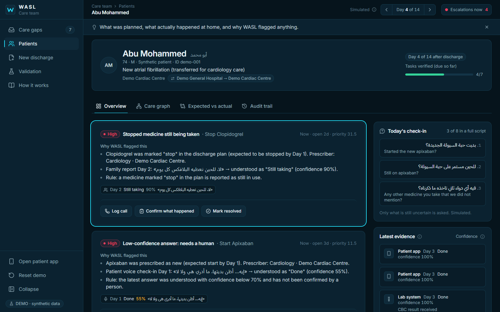
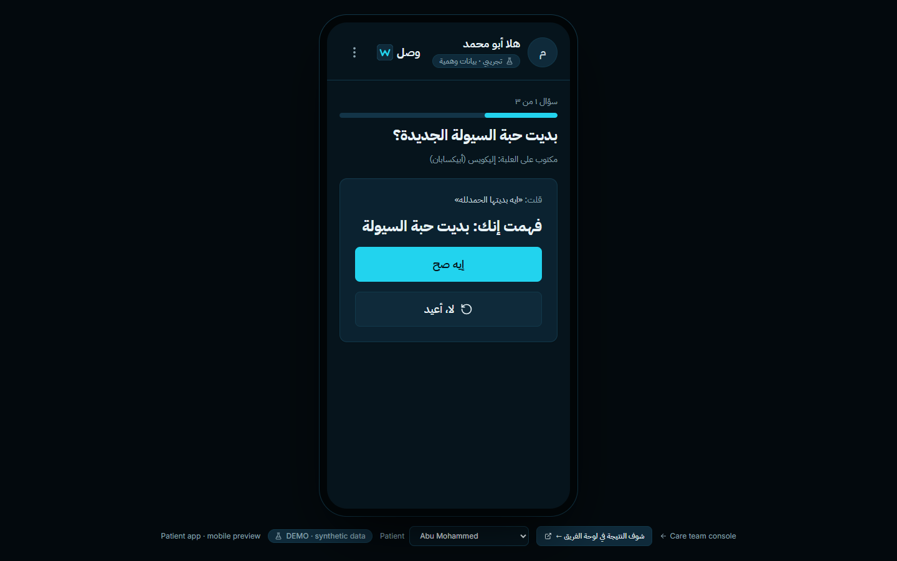
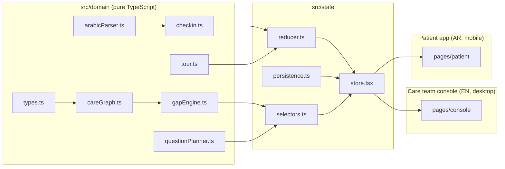

# WASL (وصل): The Executable Discharge Plan

**Turning discharge instructions into verified recovery actions.**

[](https://ameer389.github.io/wasl-mvp/)
[](https://ameer389.github.io/wasl-mvp/#/)


- **Live demo:** https://ameer389.github.io/wasl-mvp/ (replace `ameer389` with the GitHub user or org that hosts the repo)
- **Start the guided demo (3 min):** open the demo and press *Start the guided demo*. It follows one synthetic patient’s plan and demonstrates how a clinician can review and act on a gap from seeded evidence.

> **Research prototype. Not a medical device. Synthetic data only.** WASL never recommends doses, prescribes or diagnoses. It surfaces gaps and routes them to a human.

---

## The problem

After discharge, changes made at home can differ from the written plan. Stopped medicines may still be used, new doses may be missed, and labs or follow-ups can slip.

## What WASL does

1. **Plan → tasks.** A discharge plan becomes a care graph: each medicine, lab and follow-up is a task with an owner, a deadline and a risk level.
2. **Patient answers.** Patients or family members can use Saudi Arabic voice input, text or quick answers when the planner finds eligible questions.
3. **Expected vs actual.** The engine compares the plan with eligible answers and simulated lab or appointment events. A verified task has eligible supporting evidence for that task. Overlapping drug classes are flagged as potential duplicate therapy for review.
4. **Clinician reviews and acts.** The demo ranks gaps by risk and displays simulated escalation or reminder routes. It records review, intervention, re-verification and closure in the audit trail. Evidence-supported resolution and administrative disposition have distinct statuses.

## Screenshots

| Care gaps queue | A gap explains itself |
|---|---|
|  |  |
| **Care graph (Fit 14 days)** | **Patient check-in question** |
|  |  |

**Patient echo:** 

## What is real vs simulated

| Area | Status |
|---|---|
| Care graph generation from a discharge plan | ✅ Built and tested |
| Gap engine (12 gap types, verification threshold, routing, resolutions) | ✅ Built and tested |
| Saudi-dialect answer parser (rule-based, explainable) | ✅ Built, evaluated on a labelled set |
| Adaptive question planner | ✅ Built and tested |
| Clinician console (queue, patients, detail, graph, expected vs actual, audit, new discharge) | ✅ Built, runs in the browser |
| Patient app (check-in, family mode, medicines, appointments, help) | ✅ Built, runs in the browser |
| Voice input | ⚠️ Depends on the browser’s Web Speech API and microphone permissions. Text and quick answers remain available. |
| Patients, labs, appointments, answers | 🧪 Simulated: synthetic patients and a simulated clock |
| EHR / FHIR integration | ❌ Not built |
| Real database, persistence beyond the browser | ❌ Not built (state is in memory and localStorage) |
| Authentication and roles | ❌ Not built |
| Notifications to patients and clinicians | ❌ Not built |
| Production Saudi-dialect speech recognition | ❌ Not built |

## Safety by design

- **No autonomous clinical decisions.** Reasons are descriptive and tested not to be prescriptive (no "increase", "stop taking", "double", …).
- **Low confidence goes to a human.** Answers below 70% confidence cannot verify a task. Relevant uncertain evidence can trigger clarification.
- **Explainable.** Every gap shows the expected task, the evidence (with the patient's exact words), and the rule that fired.
- **Audit trail.** Every answer, call, confirmation and resolution is recorded with the day, time, actor and note.
- **Synthetic data only.** No real patient data. Every screen shows a *DEMO · synthetic data* badge.
- **Voice privacy.** The browser’s speech service may process audio remotely. Use synthetic statements only.

## Validation

All results come from synthetic data generated by the team, except the external check once it is collected. They test the logic of the prototype, not clinical effectiveness. Real-user and clinical validation have not been done yet.

| Test | Result | Data |
|---|---|---|
| Gap detection recall | **100%** (67 of 67 injected gaps) | 50 synthetic scenarios |
| Gap detection precision | **100%** (0 unexpected gaps) | same |
| False positives on clean cases | **0** in 10 clean controls × 15 days | synthetic controls |
| High-risk gaps routed to a clinician now | **100%** (23 of 23) | same |
| Focused Phase 06 gap detection | **7/7** expected, 0 unexpected, 0 on clean control, **1/1** high-risk route | separate synthetic cases |
| Phase 04B parser agreement | **65/78 (83.3%)** intent, **12/20 (60%)** difficult subset, **5/9 (55.6%)** exact medicine extraction | repeated comparison using synthetic written Saudi Arabic answers |
| Parser label disagreements | **11/13** below 0.7. Both at or above the threshold are generic dosage denials | same |
| Question planning | **1,747 vs 8,304 (79.0% fewer)** | 900 synthetic patient-days against a hypothetical full daily script |
| Scheduling replay | **466/466** eligible tasks reached, including **135/135** high-risk tasks | separate assumed one-session-per-day replay with zero answers |
| Safety invariants | **5 of 5** passed | automated tests |
| External real-user check | **Pending** | — |

**Caveats.**
- The team authored the rules, synthetic scenarios and written parser benchmark. Phase 04B reused the frozen split and labels. Live speech recognition and independent accuracy remain unmeasured.
- The planning comparison counts planned questions. Replay coverage counts tasks reached under simulated presentations. Actual presentations, answers and staff time were unmeasured in these comparisons.

Full details: [`validation/RESULTS.md`](validation/RESULTS.md). The same numbers, with the methods and limitations, are on the **Validation** page of the console.

**Not tested yet:** real patients, real clinicians working the queue, real voice recordings at scale, EHR integration, clinical outcomes.

## Architecture



Domain logic has no React and no I/O, so it is unit-tested directly. The store wires it to the two apps and persists state to localStorage. `validation/` holds the labelled data and the validation scripts.

## Run locally

```bash
npm install
npm run dev        # http://localhost:5173/wasl-mvp/
npm test           # unit tests (Vitest)
npm run build      # type-check and production build
npm run validate   # writes validation/results.json and RESULTS.md
npm run eval:parser -- --dev-only  # development evaluation without rewriting the Phase 04 result
```

Browser checks (`npm run check:views`) need the dev server running and a local Chrome install.
For the integrated new-patient check, run `npm run build`, start `npm run preview -- --host 127.0.0.1 --port 4173 --strictPort`, then run `node scripts/check-integrated.mjs`.
See the [Phase 08 engineering report](docs/phase08-engineering-handoff.md) for installation findings and domain contracts.

### Optional local HUMAIN Voice experiment

Use Node 24 and `npm ci`. Configure `.env.humain.local` privately using `.env.example`, start `npm run voice:broker` in a separate terminal, and set `VITE_HUMAIN_VOICE_ENABLED=true` when starting the app on `http://127.0.0.1:5173/wasl-mvp/`. Open the HUMAIN check-in link on the synthetic patient’s Today page and consent before starting. Review and confirm each answer in WASL. The standard check-in can run on its own. See the [Phase 09B handoff](docs/phase09b-hybrid-voice-integration.md).

## Tech stack

Vite · React 19 · TypeScript · Tailwind CSS v4 · React Router (HashRouter, for GitHub Pages) · Vitest · lucide-react · Web Speech API · GitHub Actions (build and deploy to GitHub Pages) · Playwright-core (browser checks)

## Team

- Osama AlGhamdi
- Abdullah Alahmadi
- Ameer AlGhamdi
- Abdulmalik Alzahrani
- Faisal Alorabi

MEDATHON 2026 · Filter 2 · Track 2: Healthcare Digital Transformation

---

**Disclaimer.** WASL is a research prototype built for a hackathon. It is not a medical device, it has not been clinically validated, and it must not be used for real patients. All patients, hospitals, medicines' schedules and answers are synthetic.
